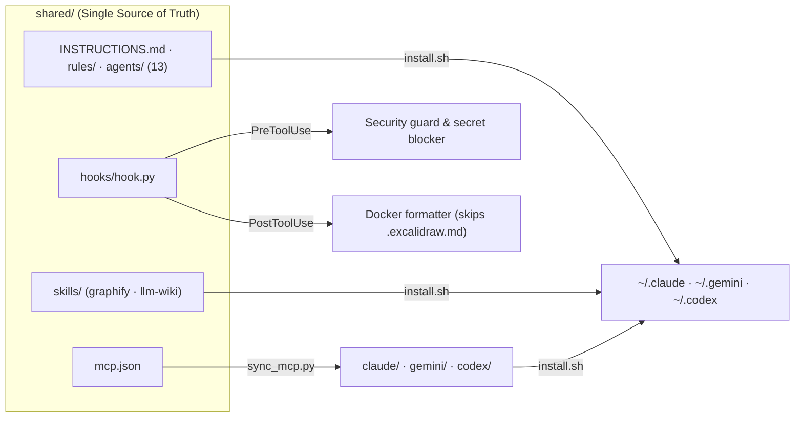

<div align="center">

[한국어](./README.md) | **English**

# Agents Config

Cross-vendor **Single Source of Truth (SSoT)** for **Claude Code · Gemini CLI / Antigravity · Codex CLI**

[](https://github.com/gdtknight/agents-config/actions/workflows/ci.yml)
[](./LICENSE)
[](#installation--usage)
[](#cross-vendor-symlink--mcp-mapping)

[Architecture Guide (EN)](./docs/ARCHITECTURE.md) · [아키텍처 가이드 (한국어)](./docs/ARCHITECTURE.ko.md) · [Repository Wiki](./wiki/overview.md) · [Security Policy](./SECURITY.md) · [Changelog](./CHANGELOG.md)

</div>

---

## Problem & Key Design Decisions

| Problem | Design Decision | Reference |
| :--- | :--- | :--- |
| Config, skill, MCP, and hook payload drift across 3 AI coding CLIs | `shared/` SSoT + `sync_mcp.py` + `hook.py` payload normalization | [ADR-02](./docs/ARCHITECTURE.md#adr-02-shared-ssot--unified-hook-payload-normalization) |
| Clean-machine bootstrapping without third-party dotfile managers | Dependency-free Bash 3.2+ orchestrator (`install.sh`) + `curl` bootstrap | [ADR-01](./docs/ARCHITECTURE.md#adr-01-bash-32-single-orchestrator-installsh-over-stow--chezmoi) |
| Multi-language formatter drift and Prettier corrupting `.excalidraw.md` | Ephemeral Docker formatter (`agents-config-formatter`) + Excalidraw bypass | [ADR-03](./docs/ARCHITECTURE.md#adr-03-ephemeral-docker-formatter--excalidraw-exclusion-guard) |
| Stateless RAG re-derivation and broken raw Excalidraw JSON from LLMs | 3-layer `llm-wiki` workflow + deterministic generator (`excalidraw_gen.py`) | [ADR-04](./docs/ARCHITECTURE.md#adr-04-deterministic-json-spec-excalidraw-generator-excalidraw_genpy) |

---

## Architecture Overview



- **Deep-dive Architecture Guides** (C4 Model, sequence diagrams, ADRs):
  - [docs/ARCHITECTURE.md](./docs/ARCHITECTURE.md)
  - [docs/ARCHITECTURE.ko.md](./docs/ARCHITECTURE.ko.md)
- **Repository Knowledge Base** (Obsidian + Excalidraw):
  - [wiki/overview.md](./wiki/overview.md)

---

## Installation & Usage

### Remote One-Line Quickstart (`curl`)

> Clones or fast-forwards `AGENTS_CONFIG_BRANCH` (default `main`) into `~/.agents-config` (or `AGENTS_CONFIG_DIR`) before running local setup.  
> Set `AGENTS_CONFIG_REMOTE_URL` to install from a fork or mirror.

#### SDKMAN Style (Piped Execution)

- **Full setup** (MCP sync + 3-vendor symlinks + CLI checks):

```bash
curl -fsSL https://raw.githubusercontent.com/gdtknight/agents-config/main/install.sh | bash
```

- **Dry-run preview** (no filesystem writes):

```bash
curl -fsSL https://raw.githubusercontent.com/gdtknight/agents-config/main/install.sh | bash -s -- --dry-run
```

- **Symlinks and MCP only** (skip CLI installation checks):

```bash
curl -fsSL https://raw.githubusercontent.com/gdtknight/agents-config/main/install.sh | bash -s -- --skip-cli
```

#### Homebrew Style (`/bin/bash -c`)

- **Full setup**:

```bash
/bin/bash -c "$(curl -fsSL https://raw.githubusercontent.com/gdtknight/agents-config/main/install.sh)"
```

- **Dry-run preview**:

```bash
/bin/bash -c "$(curl -fsSL https://raw.githubusercontent.com/gdtknight/agents-config/main/install.sh)" -- --dry-run
```

### Local Repository Execution

> Conflicting files or directories are automatically backed up to `~/.agents-config_backups/backup_YYYYMMDD_HHMMSS/` before linking.  
> Pass `--force` (`-f`) to force relinking existing matching symlinks.

- **Preview changes without touching disk**:

```bash
./install.sh --dry-run
```

- **Full setup (MCP sync + 3-vendor symlinks + CLI checks)**:

```bash
./install.sh
```

- **Sync symlinks and MCP only (skip CLI checks)**:

```bash
./install.sh --skip-cli
```

- **Target specific vendors**:

```bash
./install.sh claude gemini
```

- **Re-sync shared MCP definitions only**:

```bash
./install.sh mcp
```

- **Build PostToolUse Docker formatter image (optional)**:

```bash
./install.sh formatter
```

---

## Cross-Vendor Symlink & MCP Mapping

| Component | Claude (`~/.claude`) | Gemini / AGY (`~/.gemini`) | Codex (`~/.codex`) |
| :--- | :--- | :--- | :--- |
| Global instructions | `CLAUDE.md` | `GEMINI.md` | `AGENTS.md` |
| Modular rules | `rules/` | `config/rules/` | `rules/` |
| Specialized subagents | `agents/` | `agents/`, `config/skills/<name>/SKILL.md` | `agents/`, `skills/<name>/SKILL.md` |
| Shared skills | `skills/<skill>/` | `config/skills/<skill>/` | `skills/<skill>/` |
| Lifecycle hooks | `hooks/`, `settings.json` | `config/hooks/`, `settings.json`, `config/hooks.json` | `hooks/` |
| MCP servers | `~/.claude.json` (`mcpServers` merge) | `config/mcp_config.json` | `config.toml` (`[mcp_servers.*]`) |

---

## Core Capabilities

### 1. Specialized Subagents (13 Agents · Model Tiering)

| Category | Deep Reasoning (`opus` / `high` / `pro`) | Fast Execution (`sonnet` / `medium` / `flash`) |
| :--- | :--- | :--- |
| **Review** | `code-reviewer`, `security-reviewer`, `quality-reviewer` | — |
| **Testing** | `test-agent` | `unit-test-agent`, `integration-test-agent` |
| **Debugging & Refactoring** | `debug-agent`, `refactor-agent` | — |
| **Docs & Git** | `guide-writer`, `human-writer` | `commit-agent`, `github-agent`, `docs-agent` |

- **Built-in GitHub Flow (`commit-agent`, `github-agent`)**:
  - Protects `main`/`master` and enforces issue-based branches (`feat/<N>-*`, `fix/<N>-*`)
  - Formats issue-linked commit titles (`[#N]` default, `- #N` for strict Conventional Commit parsers)
  - Prevents missing Milestone and GitHub Project metadata (prompts to create when absent)
  - Enforces `--body-file` + `shell=False` for markdown Issue/PR operations
  - Runs `gh pr checks` before merge and syncs completed Issue checkboxes (`- [x]`)

### 2. Shared Skills (2)

- **`llm-wiki`** (`shared/skills/llm-wiki/`):
  - Maintains 3-layer Obsidian + Excalidraw wikis (`raw/`, `wiki/`, [WIKI_SCHEMA.md](./WIKI_SCHEMA.md))
  - `excalidraw_gen.py`: CJK width sizing, deterministic seeds, `LR`/`TB` auto-layout, bidirectional bindings, and `## Element Links`
  - `wiki_tool.py`: vault scaffolding (`init`), link/frontmatter/orphan/Excalidraw checks (`lint`), and append-only logs (`log`)
- **`graphify`** (`shared/skills/graphify/`):
  - Extracts AST code structures and semantic knowledge graphs with community clustering

### 3. Unified Lifecycle Hook (`shared/hooks/hook.py`)

- **`PreToolUse` (Security Guard)**:
  - Blocks destructive commands (`git push --force`, `git reset --hard`, `git clean -f`, `git checkout .`/`-f`, `mkfs`, `dd`)
  - Selectively blocks recursive `rm` and `chmod -R 777` targeting `/`, `~`, or critical system directories
  - Blocks `.env`/SSH key/credential file access and leaked API token patterns
- **`PostToolUse` (Auto-Formatter)**:
  - Runs ephemeral `agents-config-formatter:latest` Docker containers (with local binary fallback)
  - Automatically skips `.excalidraw.md` and `.excalidraw` files to protect Obsidian blocks
- **`Stop` (Completion Alerts)**:
  - Sends native macOS notifications (`terminal-notifier` with AppleScript fallback)

---

## Initializing a Personal Obsidian Vault

- **Scaffold a new or existing Obsidian vault with LLM Wiki directories**:

```bash
python3 shared/skills/llm-wiki/scripts/wiki_tool.py init "${HOME}/Library/Mobile Documents/iCloud~md~obsidian/Documents/<VaultName>" --name "<Wiki Title>" --domain "<Domain>"
```

- **Validate frontmatter, wikilinks, index coverage, and Excalidraw schemas**:

```bash
python3 shared/skills/llm-wiki/scripts/wiki_tool.py lint "${HOME}/Library/Mobile Documents/iCloud~md~obsidian/Documents/<VaultName>"
```

---

## Testing & CI Verification

- **Run unit & integration test suite (Python stdlib, 17 cases)**:

```bash
python3 -m unittest discover -s tests -v
```

- **Check shell syntax**:

```bash
bash -n install.sh docker/formatter/build.sh
```

- **Lint repository wiki**:

```bash
python3 shared/skills/llm-wiki/scripts/wiki_tool.py lint .
```

- **CI Pipeline** ([ci.yml](./.github/workflows/ci.yml)):
  - `Lint, Schema & Unit Tests` (`ubuntu-latest`): `shellcheck`, `bash -n`, `py_compile`, JSON/TOML validation, `unittest`, `wiki_tool.py lint`, and `excalidraw_gen.py validate`
  - `Installer Matrix` (`ubuntu-latest`, `macos-latest`): isolated-`HOME` dry-run, install, idempotency, and piped `--help` verification
- **License**: [MIT License](./LICENSE)
