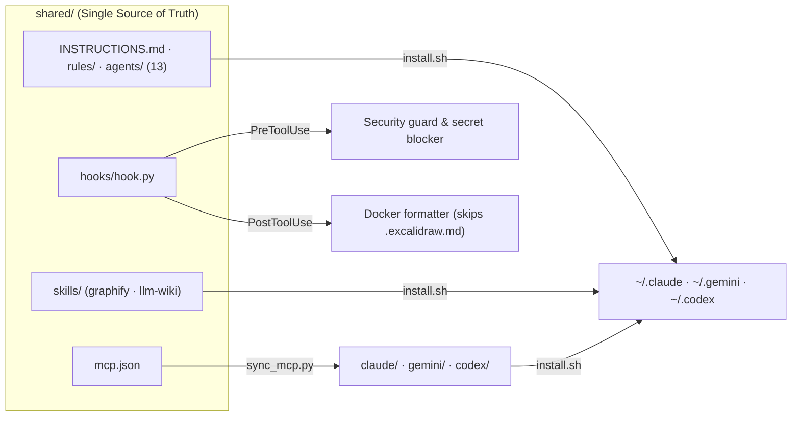

[한국어](./README.md) | **English**

# Agents Config

[](https://github.com/gdtknight/agents-config/actions/workflows/ci.yml)
[](./LICENSE)
[](#installation--usage)
[](#cross-vendor-symlink--mcp-mapping)

A cross-vendor **Single Source of Truth (SSoT)** platform that unifies engineering instructions, rules, 13 specialized subagents, shared skills (`llm-wiki`, `graphify`), lifecycle hooks, and MCP servers across **Claude Code**, **Gemini CLI / Antigravity**, and **Codex CLI**.

---

## Problem & Key Design Decisions

| Problem | Design Decision | Reference |
| :--- | :--- | :--- |
| Config, skill, MCP, and hook payload drift across 3 AI coding CLIs | `shared/` SSoT + `sync_mcp.py` + `hook.py` payload normalization | [ADR-02](./docs/ARCHITECTURE.md#adr-02-shared-ssot--unified-hook-payload-normalization) |
| Clean-machine bootstrapping without third-party dotfile managers | Dependency-free Bash 3.2+ orchestrator (`install.sh`) + `curl` bootstrap | [ADR-01](./docs/ARCHITECTURE.md#adr-01-bash-32-single-orchestrator-installsh-over-stow--chezmoi) |
| Multi-language formatter drift and Prettier corrupting `.excalidraw.md` | Ephemeral Docker formatter (`agents-config-formatter`) + Excalidraw bypass | [ADR-03](./docs/ARCHITECTURE.md#adr-03-ephemeral-docker-formatter--excalidraw-exclusion-guard) |
| Stateless RAG re-derivation and broken raw Excalidraw JSON from LLMs | 3-layer `llm-wiki` workflow + deterministic generator (`excalidraw_gen.py`) | [ADR-04](./docs/ARCHITECTURE.md#adr-04-deterministic-json-spec-excalidraw-generator-excalidraw_genpy) |

---

## Architecture Overview



- Deep-dive guide (C4 Model, sequence diagrams, ADRs): [docs/ARCHITECTURE.md](./docs/ARCHITECTURE.md) | [docs/ARCHITECTURE.ko.md](./docs/ARCHITECTURE.ko.md)
- Repository knowledge base (Obsidian + Excalidraw): [wiki/overview.md](./wiki/overview.md)

---

## Installation & Usage

### Remote One-Line Quickstart (`curl`)

```bash
# SDKMAN style (piped execution)
curl -fsSL https://raw.githubusercontent.com/gdtknight/agents-config/main/install.sh | bash
curl -fsSL https://raw.githubusercontent.com/gdtknight/agents-config/main/install.sh | bash -s -- --dry-run
curl -fsSL https://raw.githubusercontent.com/gdtknight/agents-config/main/install.sh | bash -s -- --skip-cli

# Homebrew style (/bin/bash -c)
/bin/bash -c "$(curl -fsSL https://raw.githubusercontent.com/gdtknight/agents-config/main/install.sh)"
/bin/bash -c "$(curl -fsSL https://raw.githubusercontent.com/gdtknight/agents-config/main/install.sh)" -- --dry-run
```

- Clones or fast-forwards `AGENTS_CONFIG_BRANCH` (default `main`) into `~/.agents-config` (or `AGENTS_CONFIG_DIR`) before running local setup.
- Set `AGENTS_CONFIG_REMOTE_URL` to install from a fork or mirror.

### Local Repository Execution

```bash
# 1. Preview changes without touching disk
./install.sh --dry-run

# 2. Full setup (MCP sync + 3-vendor symlinks + CLI checks)
./install.sh

# 3. Sync symlinks and MCP only (skip CLI installer checks)
./install.sh --skip-cli

# 4. Target specific modules
./install.sh claude gemini
./install.sh mcp

# 5. Build PostToolUse Docker formatter image (optional)
./install.sh formatter
```

- Conflicting files or directories are automatically backed up to `~/.agents-config_backups/backup_YYYYMMDD_HHMMSS/` before linking.
- Pass `--force` (`-f`) to force relinking existing matching symlinks.

---

## Cross-Vendor Symlink & MCP Mapping

| Component | Claude (`~/.claude`) | Gemini / AGY (`~/.gemini`) | Codex (`~/.codex`) |
| :--- | :--- | :--- | :--- |
| Global instructions | `CLAUDE.md` | `GEMINI.md` | `AGENTS.md` |
| Modular rules | `rules/` | `config/rules/` | `rules/` |
| Specialized subagents | `agents/` | `agents/`, `config/skills/<name>/SKILL.md` | `agents/`, `skills/<name>/SKILL.md` |
| Shared skills | `skills/<skill>/` | `config/skills/<skill>/` | `skills/<skill>/` |
| Lifecycle hooks | `hooks/`, `settings.json` | `config/hooks/`, `settings.json`, `config/hooks.json` | `hooks/` |
| MCP servers | `~/.claude.json` (`mcpServers` merge) | `config/mcp_config.json` | `config.toml` (`[mcp_servers.*]`) |

---

## Core Capabilities

- **13 Specialized Subagents with Model Tiering**:
  - Deep reasoning tier (`opus` / `high` / `pro`): `code-reviewer`, `security-reviewer`, `quality-reviewer`, `test-agent`, `debug-agent`, `refactor-agent`, `guide-writer`, `human-writer`
  - Fast execution tier (`sonnet` / `medium` / `flash`): `unit-test-agent`, `integration-test-agent`, `commit-agent`, `github-agent`, `docs-agent`
  - `commit-agent` and `github-agent` enforce GitHub Flow branch protection, issue-linked commits (`[#N]` / `- #N`), Milestone & GitHub Project checks, `--body-file` + `shell=False` body safety, and CI-gated issue checkbox synchronization.
- **Shared Skills (2)**:
  - `llm-wiki`: Obsidian + Excalidraw 3-layer knowledge base workflow (`raw/` · `wiki/` · [WIKI_SCHEMA.md](./WIKI_SCHEMA.md)) backed by `wiki_tool.py` and `excalidraw_gen.py`
  - `graphify`: AST & semantic knowledge graph builder and query engine
- **Unified Lifecycle Hook (`shared/hooks/hook.py`)**:
  - `PreToolUse`: Blocks destructive commands (`git push --force`, `git reset --hard`, root/home `rm`/`chmod`), `.env`/key file reads/writes, and leaked API token patterns
  - `PostToolUse`: Runs `agents-config-formatter:latest` or local formatter fallback (automatically skips `.excalidraw.md` and `.excalidraw`)
  - `Stop`: Sends native macOS notifications (`terminal-notifier` with AppleScript fallback)

---

## Initializing a Personal Obsidian Vault

```bash
# Scaffold an Obsidian vault with raw/, wiki/, templates/, and WIKI_SCHEMA.md
python3 shared/skills/llm-wiki/scripts/wiki_tool.py init \
  "${HOME}/Library/Mobile Documents/iCloud~md~obsidian/Documents/<VaultName>" \
  --name "<Wiki Title>" \
  --domain "<Domain>"

# Validate frontmatter, wikilinks, index coverage, and Excalidraw schemas
python3 shared/skills/llm-wiki/scripts/wiki_tool.py lint \
  "${HOME}/Library/Mobile Documents/iCloud~md~obsidian/Documents/<VaultName>"
```

---

## Testing & CI Verification

```bash
# Stdlib unit & integration test suite (17 test cases)
python3 -m unittest discover -s tests -v

# Shell syntax, wiki lint & Excalidraw schema validation
bash -n install.sh docker/formatter/build.sh
python3 shared/skills/llm-wiki/scripts/wiki_tool.py lint .
```

- GitHub Actions ([ci.yml](./.github/workflows/ci.yml)) runs 3 jobs on every push and PR: `Lint, Schema & Unit Tests` plus `Installer Matrix` across `ubuntu-latest` and `macos-latest`.
- License: [MIT License](./LICENSE)
