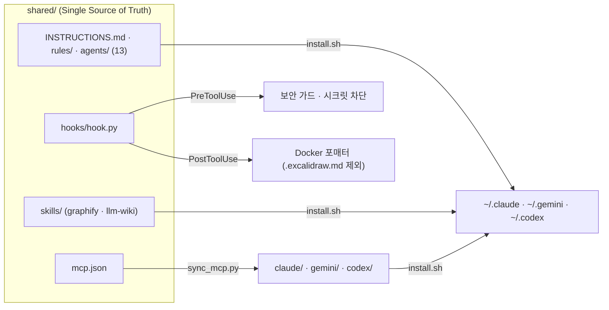

<div align="center">

**한국어** | [English](./README.en.md)

# Agents Config

**Claude Code · Gemini CLI / Antigravity · Codex CLI** 통합 설정·에이전트·스킬·훅·MCP 단일 진실 공급원(SSoT)

[](https://github.com/gdtknight/agents-config/actions/workflows/ci.yml)
[](./LICENSE)
[](#설치-및-사용법)
[](#3사-심볼릭-링크-및-mcp-매핑)

[아키텍처 가이드 (한국어)](./docs/ARCHITECTURE.ko.md) · [Architecture Guide (EN)](./docs/ARCHITECTURE.md) · [저장소 위키](./wiki/overview.md) · [보안 정책](./SECURITY.md) · [변경 이력](./CHANGELOG.md)

</div>

---

## 문제 배경 및 설계 결정

| 해결하려는 문제 | 설계 결정 | 상세 근거 |
| :--- | :--- | :--- |
| 3사 AI 에이전트마다 상이한 설정·스킬·MCP·훅 포맷으로 인한 중복 관리 | `shared/` SSoT + `sync_mcp.py` + `hook.py` 페이로드 정규화 | [ADR-02](./docs/ARCHITECTURE.ko.md#adr-02-shared-단일-진실-공급원--훅-페이로드-정규화) |
| 클린 머신 환경에서의 의존성 충돌 및 원격 설치 불편 | Bash 3.2+ 단일 오케스트레이터(`install.sh`) + `curl` 부트스트랩 | [ADR-01](./docs/ARCHITECTURE.ko.md#adr-01-외부-도구-대신-bash-32-단일-오케스트레이터installsh-채택) |
| 다언어 포매터 환경 오염 및 Obsidian `.excalidraw.md` 손상 위험 | 단발성 Docker 포매터(`agents-config-formatter`) + Excalidraw 제외 가드 | [ADR-03](./docs/ARCHITECTURE.ko.md#adr-03-posttooluse-단발성-docker-포매터--excalidraw-제외-가드) |
| 질의마다 원문을 재해석하는 RAG 한계 및 LLM의 raw Excalidraw JSON 오류 | `llm-wiki` 3계층 워크플로우 + 결정적 생성기(`excalidraw_gen.py`) | [ADR-04](./docs/ARCHITECTURE.ko.md#adr-04-obsidian-excalidraw의-json-스펙-기반-결정적-생성기excalidraw_genpy) |

---

## 전체 아키텍처



- **심화 아키텍처 문서** (C4 Model, 시퀀스 다이어그램, ADR 전체):
  - [docs/ARCHITECTURE.ko.md](./docs/ARCHITECTURE.ko.md)
  - [docs/ARCHITECTURE.md](./docs/ARCHITECTURE.md)
- **저장소 자체 운영 위키** (Obsidian + Excalidraw):
  - [wiki/overview.md](./wiki/overview.md)

---

## 설치 및 사용법

### 원격 원라인 설치 (`curl`)

> 원격 실행 시 `~/.agents-config`(또는 `AGENTS_CONFIG_DIR`) 경로에 `AGENTS_CONFIG_BRANCH`(기본 `main`) 브랜치를 클론·갱신한 뒤 설치 진행.  
> 포크·미러 저장소 사용 시 `AGENTS_CONFIG_REMOTE_URL` 환경 변수로 URL 지정 가능.

#### SDKMAN 스타일 (파이프 실행)

- **기본 전체 설치** (MCP 동기화 + 3사 링크 + CLI 설치 확인):

```bash
curl -fsSL https://raw.githubusercontent.com/gdtknight/agents-config/main/install.sh | bash
```

- **사전 점검 드라이런** (디스크 변경 없음):

```bash
curl -fsSL https://raw.githubusercontent.com/gdtknight/agents-config/main/install.sh | bash -s -- --dry-run
```

- **CLI 설치 확인 제외** (링크·MCP만 반영):

```bash
curl -fsSL https://raw.githubusercontent.com/gdtknight/agents-config/main/install.sh | bash -s -- --skip-cli
```

#### Homebrew 스타일 (`/bin/bash -c`)

- **기본 전체 설치**:

```bash
/bin/bash -c "$(curl -fsSL https://raw.githubusercontent.com/gdtknight/agents-config/main/install.sh)"
```

- **사전 점검 드라이런**:

```bash
/bin/bash -c "$(curl -fsSL https://raw.githubusercontent.com/gdtknight/agents-config/main/install.sh)" -- --dry-run
```

### 로컬 저장소 실행

> 기존 파일 충돌 시 `~/.agents-config_backups/backup_YYYYMMDD_HHMMSS/`로 자동 백업 후 심볼릭 링크 생성.  
> `--force`(`-f`) 옵션으로 기존 심볼릭 링크 강제 재연결 가능.

- **변경 내역 사전 점검 (드라이런)**:

```bash
./install.sh --dry-run
```

- **전체 연동 (MCP 동기화 + 3사 심볼릭 링크 + CLI 설치 확인)**:

```bash
./install.sh
```

- **링크 및 MCP만 반영 (CLI 설치 확인 생략)**:

```bash
./install.sh --skip-cli
```

- **특정 벤더만 선택 적용**:

```bash
./install.sh claude gemini
```

- **공용 MCP 서버만 재동기화**:

```bash
./install.sh mcp
```

- **`PostToolUse` Docker 포매터 이미지 빌드 (선택)**:

```bash
./install.sh formatter
```

---

## 3사 심볼릭 링크 및 MCP 매핑

| 구성 요소 | Claude (`~/.claude`) | Gemini / AGY (`~/.gemini`) | Codex (`~/.codex`) |
| :--- | :--- | :--- | :--- |
| 전역 지침 | `CLAUDE.md` | `GEMINI.md` | `AGENTS.md` |
| 세부 규칙 | `rules/` | `config/rules/` | `rules/` |
| 전문 에이전트 | `agents/` | `agents/`, `config/skills/<name>/SKILL.md` | `agents/`, `skills/<name>/SKILL.md` |
| 공용 스킬 | `skills/<skill>/` | `config/skills/<skill>/` | `skills/<skill>/` |
| 라이프사이클 훅 | `hooks/`, `settings.json` | `config/hooks/`, `settings.json`, `config/hooks.json` | `hooks/` |
| MCP 서버 | `~/.claude.json` (`mcpServers` 병합) | `config/mcp_config.json` | `config.toml` (`[mcp_servers.*]`) |

---

## 핵심 구성 요소

### 1. 전문 에이전트 (13종 · 모델 티어링)

| 분류 | 심층 추론 티어 (`opus` / `high` / `pro`) | 고속 실행 티어 (`sonnet` / `medium` / `flash`) |
| :--- | :--- | :--- |
| **리뷰** | `code-reviewer`, `security-reviewer`, `quality-reviewer` | — |
| **테스트** | `test-agent` | `unit-test-agent`, `integration-test-agent` |
| **디버깅·리팩토링** | `debug-agent`, `refactor-agent` | — |
| **문서·Git** | `guide-writer`, `human-writer` | `commit-agent`, `github-agent`, `docs-agent` |

- **GitHub Flow 내장 (`commit-agent`, `github-agent`)**:
  - `main`/`master` 직접 작업 차단 및 이슈 브랜치(`feat/<N>-*`, `fix/<N>-*`) 분기 유도
  - 이슈 번호 연동 커밋 제목(`[#N]` 기본, 엄격 파서 환경 시 `- #N`)
  - Milestone·GitHub Projects 누락 방지(미존재 시 생성 여부 확인)
  - `--body-file` + `shell=False` 기반 마크다운 본문 안전 전달
  - CI 게이트 확인 후 머지 및 이슈 완료 조건 체크박스(`- [x]`) 동기화

### 2. 공용 스킬 (2종)

- **`llm-wiki`** (`shared/skills/llm-wiki/`):
  - Obsidian + Excalidraw 연동 3계층 위키(`raw/`, `wiki/`, [WIKI_SCHEMA.md](./WIKI_SCHEMA.md)) 구축·유지보수
  - `excalidraw_gen.py`: CJK 폭 계산, 결정적 시드, `LR`/`TB` 자동 레이아웃, 양방향 바인딩, `## Element Links` 생성·검증
  - `wiki_tool.py`: 볼트 초기화(`init`), 링크·프론트매터·고아·Excalidraw 검사(`lint`), 연대기 기록(`log`)
- **`graphify`** (`shared/skills/graphify/`):
  - 코드·문서·미디어 대상 AST 구조 추출 및 커뮤니티 기반 지식 그래프 탐색

### 3. 통합 라이프사이클 훅 (`shared/hooks/hook.py`)

- **`PreToolUse` (보안 가드)**:
  - 파괴적 명령(`git push --force`, `git reset --hard`, `git clean -f`, `git checkout .`/`-f`, `mkfs`, `dd`) 차단
  - 루트(`/`)·홈(`~`)·시스템 디렉터리 대상 재귀 `rm` 및 `chmod -R 777` 정밀 차단
  - `.env`·SSH 개인키·인증 파일 접근 및 API 토큰 패턴 차단
- **`PostToolUse` (자동 포매터)**:
  - `agents-config-formatter:latest` 단발성 Docker 컨테이너 실행 (미가용 시 로컬 바이너리 폴백)
  - `.excalidraw.md` 및 `.excalidraw` 파일은 Prettier 포매팅에서 자동 제외
- **`Stop` (완료 알림)**:
  - macOS 네이티브 알림 전송 (`terminal-notifier` 우선, AppleScript 폴백)

---

## 개인 Obsidian 볼트 위키 초기화

- **새 볼트 또는 기존 볼트에 LLM Wiki 구조 생성**:

```bash
python3 shared/skills/llm-wiki/scripts/wiki_tool.py init "${HOME}/Library/Mobile Documents/iCloud~md~obsidian/Documents/<VaultName>" --name "<Wiki Title>" --domain "<Domain>"
```

- **위키 링크·프론트매터·Excalidraw 스키마 무결성 검증**:

```bash
python3 shared/skills/llm-wiki/scripts/wiki_tool.py lint "${HOME}/Library/Mobile Documents/iCloud~md~obsidian/Documents/<VaultName>"
```

---

## 테스트 및 CI 검증

- **단위·통합 테스트 실행 (Python 표준 라이브러리, 17개 케이스)**:

```bash
python3 -m unittest discover -s tests -v
```

- **셸 스크립트 문법 검증**:

```bash
bash -n install.sh docker/formatter/build.sh
```

- **저장소 내부 위키 린트**:

```bash
python3 shared/skills/llm-wiki/scripts/wiki_tool.py lint .
```

- **CI 파이프라인** ([ci.yml](./.github/workflows/ci.yml)):
  - `Lint, Schema & Unit Tests` (`ubuntu-latest`): `shellcheck`, `bash -n`, `py_compile`, JSON/TOML 파싱, `unittest`, `wiki_tool.py lint`, `excalidraw_gen.py validate`
  - `Installer Matrix` (`ubuntu-latest`, `macos-latest`): 격리 `HOME` 드라이런·설치·멱등성·원격 파이프 실행 검증
- **라이선스**: [MIT License](./LICENSE)
