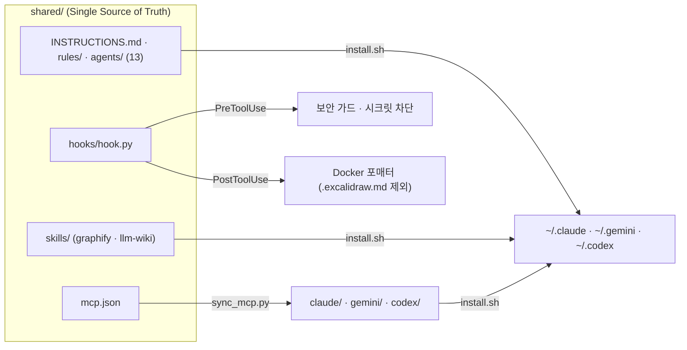

**한국어** | [English](./README.en.md)

# Agents Config

[](https://github.com/gdtknight/agents-config/actions/workflows/ci.yml)
[](./LICENSE)
[](#설치-및-사용법)
[](#3사-심볼릭-링크-및-mcp-매핑)

**Claude Code, Gemini CLI / Antigravity, Codex CLI**의 지침·규칙·13개 전문 에이전트·공용 스킬(`llm-wiki`, `graphify`)·라이프사이클 훅·MCP 서버를 **단일 진실 공급원(SSoT)** 으로 통합 관리하는 크로스 벤더 플랫폼.

---

## 문제 배경 및 설계 결정

| 해결하려는 문제 | 설계 결정 | 상세 근거 |
| :--- | :--- | :--- |
| 3사 AI 에이전트마다 상이한 설정·스킬·MCP·훅 포맷으로 인한 중복 관리 | `shared/` SSoT + `sync_mcp.py` + `hook.py` 페이로드 정규화 | [ADR-02](./docs/ARCHITECTURE.ko.md#adr-02-shared-단일-진실-공급원--훅-페이로드-정규화) |
| 클린 머신 환경에서의 의존성 충돌 및 원격 설치 불편 | Bash 3.2+ 단일 오케스트레이터(`install.sh`) + `curl` 부트스트랩 | [ADR-01](./docs/ARCHITECTURE.ko.md#adr-01-외부-도구-대신-bash-32-단일-오케스트레이터installsh-채택) |
| 다언어 포매터 환경 오염 및 Obsidian `.excalidraw.md` 손상 위험 | 단발성 Docker 포매터(`agents-config-formatter`) + Excalidraw 제외 가드 | [ADR-03](./docs/ARCHITECTURE.ko.md#adr-03-posttooluse-단발성-docker-포매터--excalidraw-제외-가드) |
| 질의마다 원문을 재해석하는 RAG 한계 및 LLM의 raw Excalidraw JSON 오류 | `llm-wiki` 3계층 워크플로우 + 결정적 생성기(`excalidraw_gen.py`) | [ADR-04](./docs/ARCHITECTURE.ko.md#adr-04-obsidian-excalidraw의-json-스펙-기반-결정적-생성기excalidraw_genpy) |

---

## 전체 아키텍처



- 심화 아키텍처(C4 Model, 시퀀스 다이어그램, ADR 전체): [docs/ARCHITECTURE.ko.md](./docs/ARCHITECTURE.ko.md) | [docs/ARCHITECTURE.md](./docs/ARCHITECTURE.md)
- 저장소 자체 운영 위키(Obsidian + Excalidraw): [wiki/overview.md](./wiki/overview.md)

---

## 설치 및 사용법

### 원격 원라인 설치 (`curl`)

```bash
# SDKMAN 스타일 (파이프 실행)
curl -fsSL https://raw.githubusercontent.com/gdtknight/agents-config/main/install.sh | bash
curl -fsSL https://raw.githubusercontent.com/gdtknight/agents-config/main/install.sh | bash -s -- --dry-run
curl -fsSL https://raw.githubusercontent.com/gdtknight/agents-config/main/install.sh | bash -s -- --skip-cli

# Homebrew 스타일 (/bin/bash -c)
/bin/bash -c "$(curl -fsSL https://raw.githubusercontent.com/gdtknight/agents-config/main/install.sh)"
/bin/bash -c "$(curl -fsSL https://raw.githubusercontent.com/gdtknight/agents-config/main/install.sh)" -- --dry-run
```

- 원격 실행 시 `~/.agents-config`(또는 `AGENTS_CONFIG_DIR`)로 `AGENTS_CONFIG_BRANCH`(기본 `main`) 브랜치를 클론·갱신한 뒤 설치 진행.
- `AGENTS_CONFIG_REMOTE_URL` 환경 변수로 포크·미러 저장소 URL 지정 가능.

### 로컬 저장소 실행

```bash
# 1. 변경 내역 사전 점검 (디스크 변경 없음)
./install.sh --dry-run

# 2. 전체 연동 (MCP 동기화 + 3사 심볼릭 링크 + CLI 설치 확인)
./install.sh

# 3. CLI 설치 확인 제외하고 링크/MCP만 반영
./install.sh --skip-cli

# 4. 특정 모듈만 선택 적용
./install.sh claude gemini
./install.sh mcp

# 5. PostToolUse Docker 포매터 이미지 빌드 (선택)
./install.sh formatter
```

- 기존 파일 충돌 시 `~/.agents-config_backups/backup_YYYYMMDD_HHMMSS/`로 자동 백업 후 심볼릭 링크 생성.
- `--force`(`-f`) 옵션으로 기존 심볼릭 링크 강제 재연결 가능.

---

## 3사 심볼릭 링크 및 MCP 매핑

| 구성 요소 | Claude (`~/.claude`) | Gemini / AGY (`~/.gemini`) | Codex (`~/.codex`) |
| :--- | :--- | :--- | :--- |
| 전역 지침 | `CLAUDE.md` | `GEMINI.md` | `AGENTS.md` |
| 세부 규칙 | `rules/` | `config/rules/` | `rules/` |
| 전문 에이전트 | `agents/` | `agents/`, `config/skills/<name>/SKILL.md` | `agents/`, `skills/<name>/SKILL.md` |
| 공용 스킬 | `skills/<skill>/` | `config/skills/<skill>/` | `skills/<skill>/` |
| 라이프사이클 훅 | `hooks/`, `settings.json` | `config/hooks/`, `settings.json`, `config/hooks.json` | `hooks/` |
| MCP 서버 | `~/.claude.json` (`mcpServers` 병합) | `config/mcp_config.json` | `config.toml` (`[mcp_servers.*]`) |

---

## 핵심 구성 요소

- **전문 에이전트 (13종, 작업 비중별 모델 티어링)**:
  - 심층 추론 (`opus`/`high`/`pro`): `code-reviewer`, `security-reviewer`, `quality-reviewer`, `test-agent`, `debug-agent`, `refactor-agent`, `guide-writer`, `human-writer`
  - 고속 실행 (`sonnet`/`medium`/`flash`): `unit-test-agent`, `integration-test-agent`, `commit-agent`, `github-agent`, `docs-agent`
  - `commit-agent`·`github-agent`에 GitHub Flow 브랜치 보호, `[#N]` 이슈 연동 커밋, Milestone·GitHub Projects 점검, `--body-file`/`shell=False` 본문 보호, CI 확인 후 이슈 체크박스 동기화 내장.
- **공용 스킬 (2종)**:
  - `llm-wiki`: Obsidian + Excalidraw 연동 3계층 위키(`raw/` · `wiki/` · [WIKI_SCHEMA.md](./WIKI_SCHEMA.md)) 구축·유지보수 (`wiki_tool.py`, `excalidraw_gen.py`)
  - `graphify`: 코드·문서 지식 그래프 구축 및 탐색
- **통합 훅 (`shared/hooks/hook.py`)**:
  - `PreToolUse`: 위험 명령(`git push --force`, `git reset --hard`, 루트·홈 `rm`/`chmod`), `.env`·키 파일 접근, API 토큰 패턴 차단
  - `PostToolUse`: `agents-config-formatter:latest` 단발성 컨테이너 또는 로컬 포매터 실행 (`.excalidraw.md`, `.excalidraw` 자동 제외)
  - `Stop`: macOS 완료 알림 (`terminal-notifier` 우선, AppleScript 폴백)

---

## 개인 Obsidian 볼트 위키 초기화

```bash
# 새 Obsidian 볼트 또는 기존 볼트에 LLM Wiki 구조 초기화
python3 shared/skills/llm-wiki/scripts/wiki_tool.py init \
  "${HOME}/Library/Mobile Documents/iCloud~md~obsidian/Documents/<VaultName>" \
  --name "<Wiki Title>" \
  --domain "<Domain>"

# 위키 링크·프론트매터·Excalidraw 무결성 검증
python3 shared/skills/llm-wiki/scripts/wiki_tool.py lint \
  "${HOME}/Library/Mobile Documents/iCloud~md~obsidian/Documents/<VaultName>"
```

---

## 테스트 및 CI 검증

```bash
# 단위·통합 테스트 (Python 표준 라이브러리, 17개 케이스)
python3 -m unittest discover -s tests -v

# 셸 문법 · 위키 린트 · Excalidraw 스키마 검증
bash -n install.sh docker/formatter/build.sh
python3 shared/skills/llm-wiki/scripts/wiki_tool.py lint .
```

- GitHub Actions([ci.yml](./.github/workflows/ci.yml))가 모든 Push/PR마다 `Lint, Schema & Unit Tests`와 `Installer Matrix` (`ubuntu-latest`, `macos-latest`) 3개 잡을 자동 실행.
- 라이선스: [MIT License](./LICENSE)
