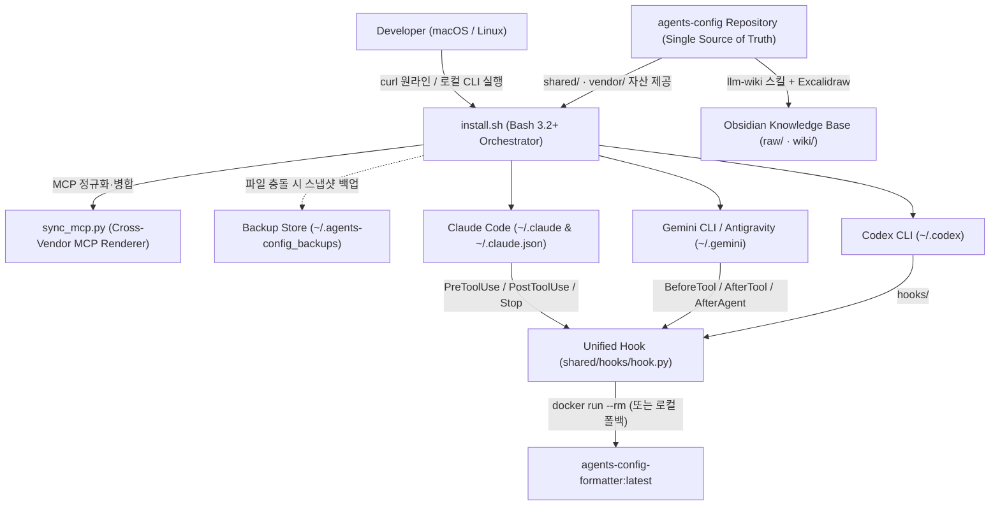
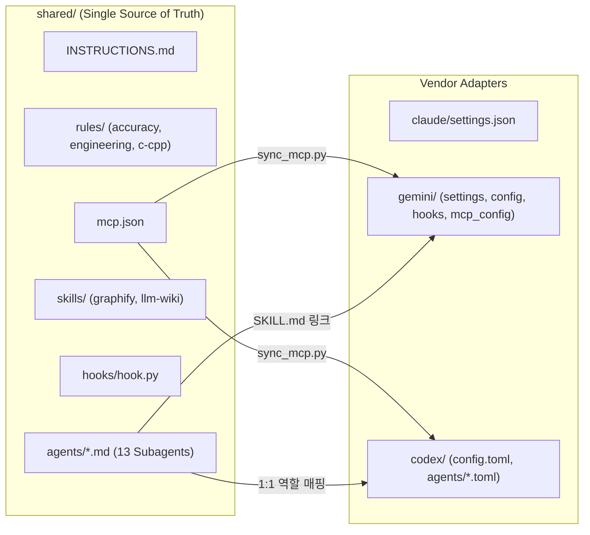
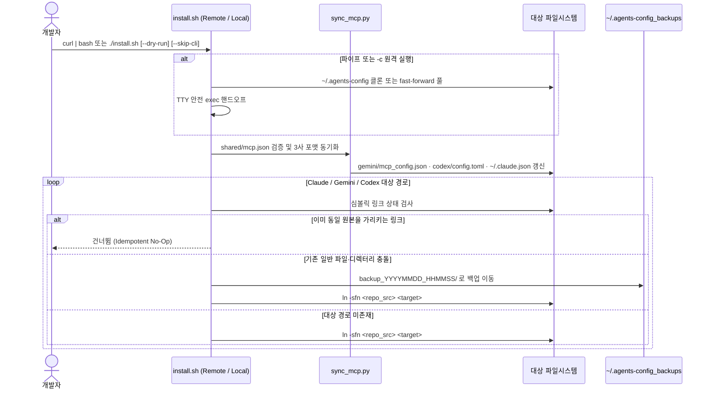
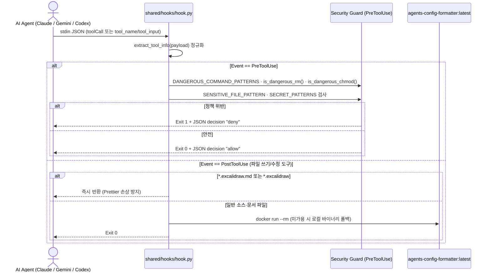
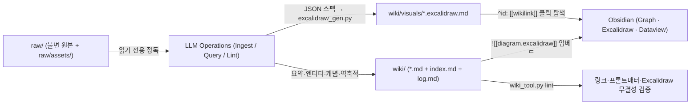

[English](./ARCHITECTURE.md) | **한국어**

# Agents Config 아키텍처 가이드 (Architecture Guide)

Claude Code, Gemini CLI / Antigravity, Codex CLI 통합 설정·에이전트·스킬·라이프사이클 훅의 시스템 구조, 런타임 워크플로우, 모듈별 설계 및 아키텍처 결정 기록(ADR).

---

## 1. 시스템 컨텍스트 및 컨테이너 아키텍처 (C4 Model)

### Level 1–2: System Context & Container Architecture

`agents-config`는 3사 AI 코딩 에이전트의 지침·서브에이전트·스킬·훅·MCP 설정을 `shared/` 단일 진실 공급원(SSoT)으로 통합하고, Bash 3.2+ 오케스트레이터([install.sh](../install.sh))로 각 호스트 디렉터리에 심볼릭 링크를 투영하는 선언적 플랫폼.

### Level 3: `shared/` 내부 컴포넌트 구조

---

## 2. 핵심 런타임 워크플로우 (Core Runtime Workflows)

### 2.1 원격 부트스트랩 및 멱등적 배포 (`install.sh`)

### 2.2 통합 라이프사이클 훅 파이프라인 ([hook.py](../shared/hooks/hook.py))

### 2.3 Obsidian + Excalidraw LLM Wiki 파이프라인

---

## 3. 모듈별 내부 설계 (Module Breakdown)

### 3.1 통합 설치 및 원격 부트스트랩 (`install.sh`)
- **Bash 3.2+ 호환성**: 연관 배열 등 Bash 4+ 전용 문법을 배제하고 `${1+"$@"}` 전달로 macOS 기본 `/bin/bash`의 `set -u` 무인자 오류 방지.
- **원격 실행 안전성**: 전체 로직을 `main()`으로 래핑해 파이프 전송 중단(`curl | bash`) 방어, 클론 전 `--help` 조기 처리, 비어 있는 디렉터리 외 충돌 감지.
- **`--dry-run` 순수성**: 벤더 디렉터리 `mkdir -p` 호출을 `DRY_RUN=false` 조건으로 격리해 시뮬레이션 시 파일시스템 미변경 보장.

### 3.2 3사 공용 에이전트·스킬·MCP (`shared/`)
- **13개 전문 에이전트 & 모델 티어링**:
  - 심층 추론 티어 (`opus` / `high` / `pro`, 8종): `code-reviewer`, `security-reviewer`, `quality-reviewer`, `test-agent`, `debug-agent`, `refactor-agent`, `guide-writer`, `human-writer`.
  - 고속 실행 티어 (`sonnet` / `medium` / `flash`, 5종): `unit-test-agent`, `integration-test-agent`, `commit-agent`, `github-agent`, `docs-agent`.
- **GitHub Flow 내장 (`commit-agent`, `github-agent`)**: `main`/`master` 보호 확인, `[#N]`/`- #N` 이슈 연동 커밋, Milestone·GitHub Projects 누락 방지, `--body-file` + `shell=False` 본문 보호, `gh pr checks` 및 이슈 체크박스 동기화.
- **공용 MCP 동기화 ([sync_mcp.py](../shared/sync_mcp.py))**: `shared/mcp.json` 단일 선언을 `gemini/mcp_config.json`, `codex/config.toml`(`[mcp_servers.*]`), `~/.claude.json`(`mcpServers` 동적 상태 보존 병합)으로 변환.

### 3.3 보안 가드 및 컨테이너 포매터 (`hook.py`, `docker/formatter/`)
- **선별 차단 (`PreToolUse`)**: `is_dangerous_rm()`과 `is_dangerous_chmod()`가 `/tmp/...`, `./dist` 등 안전한 하위 경로는 허용하고 루트(`/`)·홈(`~`)·시스템 디렉터리 전체 삭제·권한 개방만 정밀 차단.
- **격리 포매터 (`PostToolUse`)**: `debian:bookworm-slim` 기반 `agents-config-formatter:latest` 이미지에 Prettier, Ruff, Black, Clang-format, `google-java-format` v1.24.0, StyLua v2.0.2 탑재. `.excalidraw.md`/`.excalidraw` 파일은 `format_file()` 진입부에서 제외.

### 3.4 LLM Wiki & Excalidraw 툴체인 (`shared/skills/llm-wiki/`)
- **`excalidraw_gen.py`**: `unicodedata.east_asian_width` 기반 CJK 폭 계산, `zlib.crc32` 결정적 시드(재생성 시 Git diff 노이즈 방지), `LR`/`TB` 자동 레이아웃, `KIND_STYLES` 시맨틱 팔레트, 양방향 바인딩(`containerId`·`startBinding`·`endBinding`) 및 `validate` 검증 제공.
- **`wiki_tool.py`**: `init`(`--no-templates` 지원), `lint`(YAML Frontmatter·깨진 `[[wikilink]]`/`![[embed]]`·고아 페이지·`index.md` 누락·`.excalidraw.md` 스키마 검사), `log`(append-only 연대기 기록) 제공.

### 3.5 품질 검증 체계 (`tests/`, `.github/workflows/ci.yml`)
- **표준 라이브러리 테스트 스위트 (`tests/`)**: 외부 의존성 없이 `unittest`로 17개 단위·통합 테스트 실행.
- **듀얼 OS CI 매트릭스**: `ubuntu-latest` 정적·스키마·단위 테스트 + `ubuntu-latest`/`macos-latest` 설치기 격리 홈 매트릭스 실행.

---

## 4. 아키텍처 결정 기록 (Architecture Decision Records, ADRs)

### ADR-01: 외부 도구 대신 Bash 3.2+ 단일 오케스트레이터(`install.sh`) 채택
- **배경 (Context)**: GNU Stow, Chezmoi, Nix 등은 초기 워크스테이션이나 최소 리눅스 환경에 사전 설치되어 있지 않음.
- **결정 (Decision)**: 추가 의존성 없는 순수 Bash 3.2+ 스크립트(`install.sh`)로 부트스트랩, 멱등적 심볼릭 링크, 타임스탬프 백업, `--dry-run`을 통합 구현.
- **결과 (Consequences)**: `curl | bash` 1줄만으로 macOS·Ubuntu 양쪽에서 즉시 배포 가능하며 CI 매트릭스로 회귀 방지.

### ADR-02: `shared/` 단일 진실 공급원 + 훅 페이로드 정규화
- **배경 (Context)**: Claude Code, Gemini CLI, Codex CLI는 스킬 디렉터리 구조, MCP 스키마, 훅 JSON 페이로드(`toolCall` vs `tool_name`/`tool_input`)가 상이함.
- **결정 (Decision)**: `shared/`를 유일한 원본으로 두고 `sync_mcp.py`와 `install.sh`가 벤더별 어댑터를 생성·연결하며 `hook.py`의 `extract_tool_info()`로 페이로드를 단일 파이프라인으로 정규화.
- **결과 (Consequences)**: 3사 간 규칙·보안 정책·MCP 설정 불일치 제거.

### ADR-03: PostToolUse 단발성 Docker 포매터 + Excalidraw 제외 가드
- **배경 (Context)**: 다언어 포매터를 호스트에 직접 설치하면 버전 충돌이 발생하며, Prettier가 `.excalidraw.md`를 포매팅하면 Obsidian `%%...%%` 주석·`^id` 블록이 손상됨.
- **결정 (Decision)**: `agents-config-formatter:latest` 단발성 컨테이너(로컬 폴백 포함)로 실행 환경을 격리하고, `format_file()` 최상단에서 `.excalidraw.md`/`.excalidraw`를 즉시 반환.
- **결과 (Consequences)**: 일관된 코드 포매팅과 Obsidian Excalidraw 데이터 무결성 동시 보장.

### ADR-04: Obsidian Excalidraw의 JSON 스펙 기반 결정적 생성기(`excalidraw_gen.py`)
- **배경 (Context)**: LLM이 수백 줄의 raw Excalidraw JSON과 양방향 바인딩(`boundElements`, `containerId`, `startBinding`, `endBinding`)을 직접 작성하면 ID 불일치와 CJK 텍스트 박스 겹침이 빈번함.
- **결정 (Decision)**: LLM은 의미 중심의 경량 JSON 스펙만 작성하고, 표준 라이브러리 기반 `excalidraw_gen.py`가 레이아웃·CJK 크기·양방향 바인딩·`## Element Links`를 결정적으로 생성·검증.
- **결과 (Consequences)**: 스키마 오류 0건 및 결정적 시드를 통한 깔끔한 Git diff 유지.

### ADR-05: `graphify`와 `llm-wiki` 역할 분리
- **배경 (Context)**: 코드베이스의 AST 기반 구조 파악과 지식의 서사적 축적·모순 관리·시각화는 요구되는 추출 방식이 다름.
- **결정 (Decision)**: 코드/대규모 코퍼스 구조 그래프는 `graphify`가 담당하고, `raw/`·`wiki/`·`index.md`·`log.md`·Excalidraw 기반 지식 큐레이션은 `llm-wiki`가 담당하도록 공존 설계.
- **결과 (Consequences)**: 저장소 탐색 효율성과 장기 개인/운영 지식의 누적 품질을 모두 확보.

---

- 상위 개요: [README.md](../README.md)
- 저장소 내부 위키: [wiki/overview.md](../wiki/overview.md)
