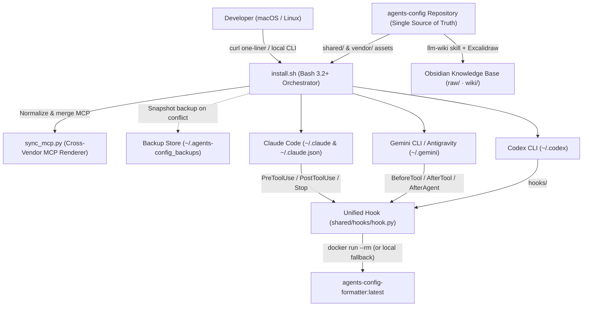
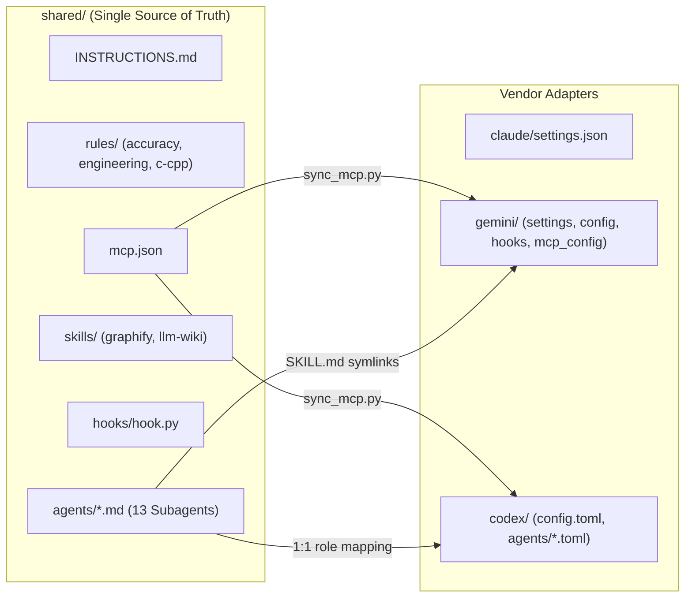
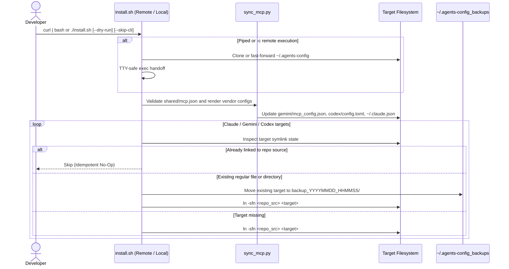
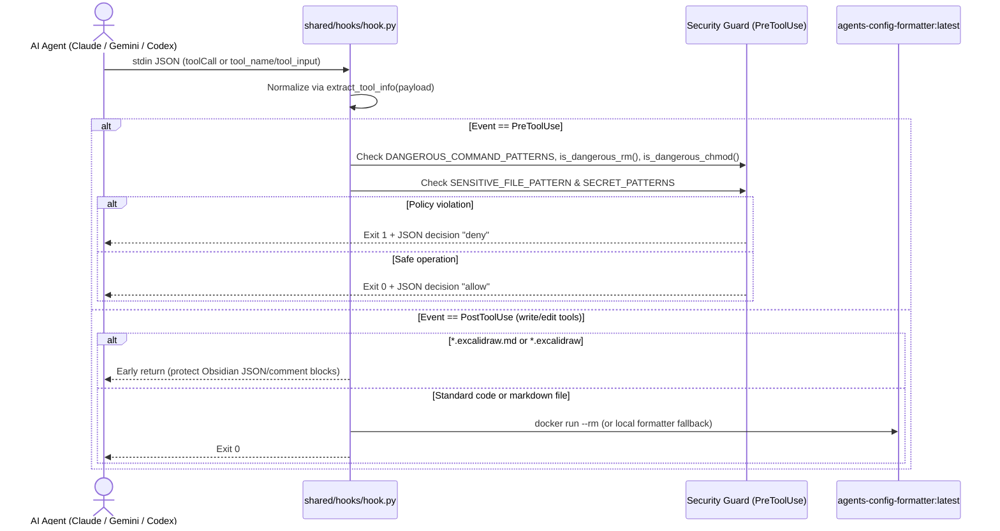
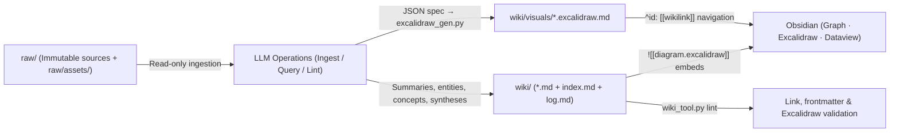

**English** | [한국어](./ARCHITECTURE.ko.md)

# Agents Config Architecture Guide

System architecture, runtime workflows, module design, and Architecture Decision Records (ADRs) for managing Claude Code, Gemini CLI / Antigravity, and Codex CLI from a single source of truth.

---

## 1. System Context & Container Architecture (C4 Model)

### Level 1–2: System Context & Container Architecture

`agents-config` centralizes prompts, rules, 13 specialized subagents, cross-vendor skills, lifecycle hooks, and MCP declarations under `shared/`, projecting them into each vendor's home directory via a Bash 3.2+ orchestrator ([install.sh](../install.sh)).

### Level 3: Internal `shared/` Component Layout

---

## 2. Core Runtime Workflows

### 2.1 Remote Bootstrap & Idempotent Deployment (`install.sh`)

### 2.2 Unified Lifecycle Hook Pipeline ([hook.py](../shared/hooks/hook.py))

### 2.3 Obsidian + Excalidraw LLM Wiki Pipeline

---

## 3. Module Breakdown

### 3.1 Installer & Remote Bootstrapper (`install.sh`)
- **Bash 3.2+ compatibility**: Avoids Bash 4+ features (associative arrays, `mapfile`) and passes `${1+"$@"}` to remain safe under `set -u` with zero arguments on stock macOS `/bin/bash`.
- **Safe remote execution**: Wraps execution in `main()`, handles `--help`/`-h` before cloning, validates non-git target directory collisions, and recovers interactive TTY via `/dev/tty`.
- **Pure `--dry-run`**: Guards directory creation (`mkdir -p`) under `DRY_RUN=false` so preview runs leave the filesystem untouched.

### 3.2 Cross-Vendor SSoT (`shared/`)
- **13 Specialized Subagents & Model Tiering**:
  - Deep reasoning tier (`opus` / `high` / `pro`, 8 agents): `code-reviewer`, `security-reviewer`, `quality-reviewer`, `test-agent`, `debug-agent`, `refactor-agent`, `guide-writer`, `human-writer`.
  - Fast execution tier (`sonnet` / `medium` / `flash`, 5 agents): `unit-test-agent`, `integration-test-agent`, `commit-agent`, `github-agent`, `docs-agent`.
- **Built-in GitHub Flow (`commit-agent`, `github-agent`)**: `main`/`master` branch protection, issue-linked commits (`[#N]` default, `- #N` for strict Conventional Commit parsers), Milestone/Project existence checks, `--body-file` + `shell=False` body safety, and `gh pr checks` + issue checkbox synchronization on merge.
- **Cross-Vendor MCP Sync ([sync_mcp.py](../shared/sync_mcp.py))**: Translates `shared/mcp.json` into Gemini `mcp_config.json` (`serverUrl`), Codex `config.toml` (`[mcp_servers.*]`), and Claude `~/.claude.json` (`mcpServers` merge preserving dynamic state).

### 3.3 Security Guard & Containerized Formatter (`hook.py`, `docker/formatter/`)
- **Selective blocking (`PreToolUse`)**: `is_dangerous_rm()` and `is_dangerous_chmod()` permit safe subpath cleanups (`/tmp/...`, `./dist`) while blocking destructive operations on `/`, `~`, and critical system directories.
- **Isolated formatter (`PostToolUse`)**: `debian:bookworm-slim` image (`agents-config-formatter:latest`) bundling Prettier, Ruff, Black, Clang-format, `google-java-format` v1.24.0, and StyLua v2.0.2, with local binary fallback and explicit exclusion for `.excalidraw.md`/`.excalidraw`.

### 3.4 LLM Wiki & Excalidraw Toolchain (`shared/skills/llm-wiki/`)
- **`excalidraw_gen.py`**: Zero-dependency generator computing CJK character widths via `unicodedata.east_asian_width`, deterministic `zlib.crc32` seeds, `LR`/`TB` layouts, semantic `KIND_STYLES`, bidirectional `containerId`/`startBinding`/`endBinding` bindings, `## Element Links`, and schema validation.
- **`wiki_tool.py`**: `init` (personal Obsidian vaults or `--no-templates` repo wikis), `lint` (frontmatter, wikilinks/embeds, orphan detection, `index.md` coverage, Excalidraw schema), and `log` (chronological append-only entries).

### 3.5 Automated Testing & CI (`tests/`, `.github/workflows/ci.yml`)
- **Stdlib test suite (`tests/`)**: 17 unit/integration tests executable via `python3 -m unittest discover -s tests` with zero third-party dependencies.
- **Dual-OS CI matrix**: `ubuntu-latest` lint/schema/unit job plus `ubuntu-latest` and `macos-latest` isolated-`HOME` installer verification matrix.

---

## 4. Architecture Decision Records (ADRs)

### ADR-01: Bash 3.2+ Single Orchestrator (`install.sh`) Over Stow / Chezmoi
- **Context**: Clean macOS workstations and minimal Linux environments lack third-party dotfile managers before bootstrap.
- **Decision**: Implement symlinking, timestamped backups, `--dry-run`, and remote `curl` bootstrap in dependency-free Bash 3.2+.
- **Consequences**: Zero-dependency one-line installation across macOS and Linux, verified on every PR via GitHub Actions.

### ADR-02: `shared/` SSoT + Unified Hook Payload Normalization
- **Context**: Claude Code, Gemini CLI, and Codex CLI differ in skill directory layouts, MCP schemas, and hook JSON payloads (`toolCall` vs `tool_name`/`tool_input`).
- **Decision**: Keep `shared/` as the sole canonical source, render vendor configs via `sync_mcp.py`, and normalize hook payloads inside `hook.py`'s `extract_tool_info()`.
- **Consequences**: Rules, security policies, skills, and MCP definitions stay synchronized across all three vendors without duplication.

### ADR-03: Ephemeral Docker Formatter + Excalidraw Exclusion Guard
- **Context**: Host-installed formatters drift across versions, and running Prettier on `.excalidraw.md` breaks Obsidian's `%%...%%` drawing blocks and `^id` anchors.
- **Decision**: Package multi-language formatters in `agents-config-formatter:latest` (with local fallback) and short-circuit `.excalidraw.md`/`.excalidraw` inside `format_file()`.
- **Consequences**: Consistent formatting across languages without corrupting Excalidraw diagrams.

### ADR-04: Deterministic JSON-Spec Excalidraw Generator (`excalidraw_gen.py`)
- **Context**: Hand-authoring raw Excalidraw v2 JSON in LLM output frequently causes dangling `boundElements` IDs and CJK text-box clipping.
- **Decision**: Have agents author compact semantic JSON specs and let `excalidraw_gen.py` compute CJK sizing, layout, deterministic seeds, bidirectional bindings, and `## Element Links`.
- **Consequences**: Zero schema errors and minimal, noise-free Git diffs on regeneration.

### ADR-05: Clear Separation Between `graphify` and `llm-wiki`
- **Context**: AST code-structure extraction and narrative personal/operational knowledge curation require different representations.
- **Decision**: Use `graphify` for structural AST/community knowledge graphs and `llm-wiki` for curated `raw/`/`wiki/` synthesis, contradiction tracking, and Excalidraw visuals.
- **Consequences**: Fast structural code queries paired with persistent, Obsidian-browsable knowledge accumulation.

---

- Overview: [README.en.md](../README.en.md)
- Repository Wiki: [wiki/overview.md](../wiki/overview.md)
